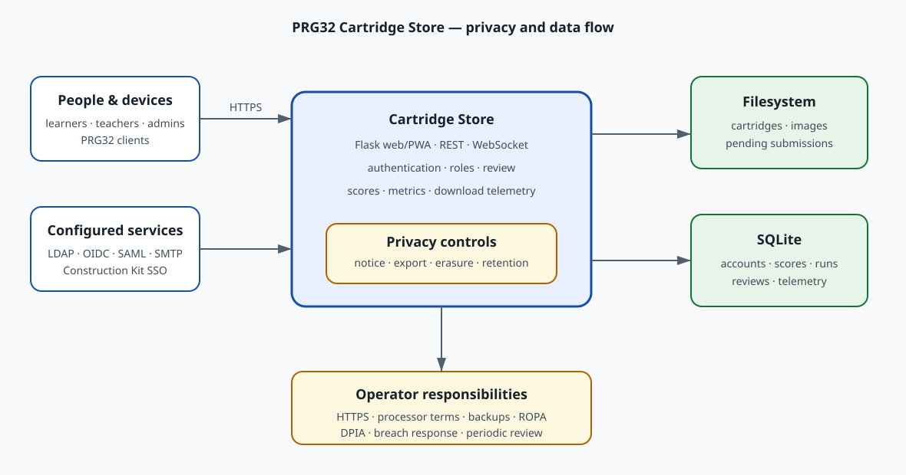

# GDPR and Privacy Operations

Cartridge Store includes technical controls that support GDPR compliance. No
software can make a deployment “perfectly compliant” by itself: the deploying
school or organisation is the data controller and must document its purposes,
lawful bases, processors, safeguards, and local legal requirements. Obtain
qualified legal advice for the actual deployment.

## Hard Requirements Before Production

The operator **must** complete all of the following before admitting users:

1. Identify the controller and configure its name, address, privacy contact,
   DPO (when appointed), and supervisory authority in `/setup`.
2. Record a lawful basis for every purpose. Do not use consent when contract,
   public task, or another basis is the correct one. If relying on legitimate
   interests for security/download telemetry, document the balancing test.
3. Publish and review `/privacy`. Add deployment-specific processors,
   recipients, international transfers, and safeguards to the organisation's
   privacy documentation.
4. Choose the shortest defensible retention periods for download telemetry,
   metrics, and incomplete registrations. Verify the daily cleanup and backup
   expiry process.
5. Require HTTPS, set `PRG32_SECURE_COOKIES=true`, protect secrets, encrypt and
   access-control backups, patch dependencies, and review administrator/editor
   access regularly.
6. Sign Article 28 terms with processors such as hosting, SMTP, identity,
   backup, and support providers. Document transfer mechanisms where data
   leaves the EEA.
7. Maintain records of processing activities, a data-subject request procedure,
   an incident/breach procedure, and a DPIA where processing is likely to pose
   high risk—especially deployments involving children or systematic
   monitoring.
8. Verify national rules for schools and minors, including the lawful basis,
   parental-authorisation rules when consent is used, and retention obligations.
9. Test access, correction, export, restriction, objection, and erasure
   handling. The in-app tools cover routine export and erasure; exceptions and
   restriction/objection requests require controller review.
10. Re-run this review whenever purposes, fields, providers, audiences,
    security controls, or law change. Record the review date and owner.

## Data Flow and Minimisation



The Store keeps cartridge binaries on the filesystem. Account, score, metrics,
review, and pseudonymous download data live in SQLite. The Store has no
advertising or non-essential tracking cookies. It stores a keyed HMAC-SHA-256
IP-derived value—not the raw address—for aggregate download telemetry; this remains
personal data when it can relate to a person and is therefore retention-bound.

External LDAP, OIDC, SAML, SMTP, reverse proxies, hosting, backup systems, and a
linked Construction Kit expand the processing boundary. The operator must
inventory and configure each one independently.

## Data-Subject Rights

- `/privacy` provides the versioned Article 13/14 notice.
- `/account/privacy` gives signed-in users the rights dashboard.
- `GET /api/me/export` provides a structured, machine-readable JSON copy.
- `POST /account/delete` erases the account and directly owned telemetry and
  metrics, revokes tokens, and anonymises identifiers on shared classroom
  records. The last administrator cannot erase itself until another admin is
  appointed.
- Account details can be corrected by an administrator. Other requests go to
  the configured privacy contact and must be handled without undue delay,
  normally within one month.

Erasure is not absolute. The controller must review legal obligations, public
interest, freedom of expression, claims, and the rights of others before
overriding a request. Backups should be isolated from routine use, expire on a
documented schedule, and not silently restore erased data into production.

## Retention and Cleanup

Defaults are intentionally finite:

| Category | Default |
| --- | ---: |
| Pseudonymous download events | 90 days |
| Metrics runs and samples | 365 days |
| Unused/expired registration records | 7 days |
| Minimal hashed erasure audit events | 6 years |

Cleanup runs at most once daily when the service receives traffic. An
administrator can run it immediately:

```bash
curl -X POST -b cookies.txt https://store.example.edu/admin/privacy/cleanup
```

The response reports deletion counts. Monitor it as an operational control.
Retention does not automatically cover proxy logs, SMTP logs, IdP logs,
container logs, exports, or backups; configure those systems separately.

## Security and Incident Response

The application sets HttpOnly/SameSite session cookies, privacy-preserving
referrer and browser capability headers, `no-store` for rights/account routes,
hashed passwords and API tokens, role-based access, upload limits, and safe
content validation. Production still requires HTTPS, secure cookies, secret
rotation, network/access controls, monitoring, tested restoration, and timely
security updates.

If a personal-data breach occurs, contain it, preserve evidence, identify the
data and people affected, assess risk, document the decision, and notify the
competent authority within 72 hours when Article 33 requires it. Notify affected
people without undue delay when Article 34's high-risk threshold is met.

## Review Sources

This baseline was reviewed on 21 October 2026 against Regulation (EU) 2016/679
and current European Commission/EDPB guidance. Legal obligations can change;
the controller must schedule periodic reviews.

- [GDPR text (EUR-Lex)](https://eur-lex.europa.eu/eli/reg/2016/679/oj)
- [European Commission: data-protection obligations](https://commission.europa.eu/law/law-topic/data-protection/information-business-and-organisations/obligations_en)
- [European Commission: handling data-subject requests](https://commission.europa.eu/law/law-topic/data-protection/information-business-and-organisations/dealing-requests-individuals_en)
- [EDPB: data protection by design and by default](https://www.edpb.europa.eu/our-work-tools/our-documents/guidelines/guidelines-42019-article-25-data-protection-design-and_en)
